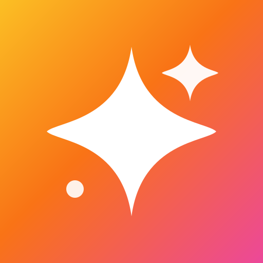
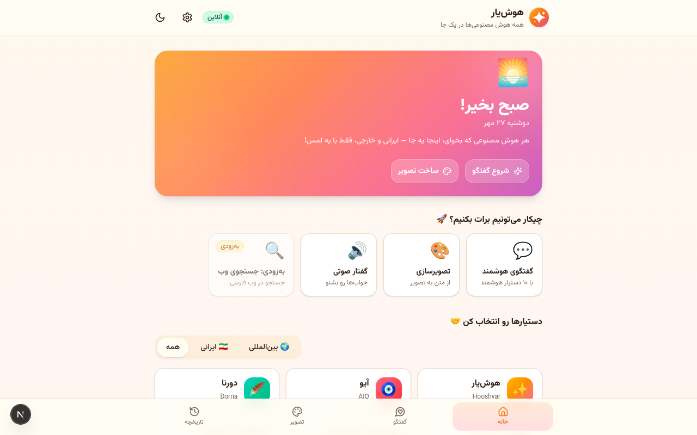
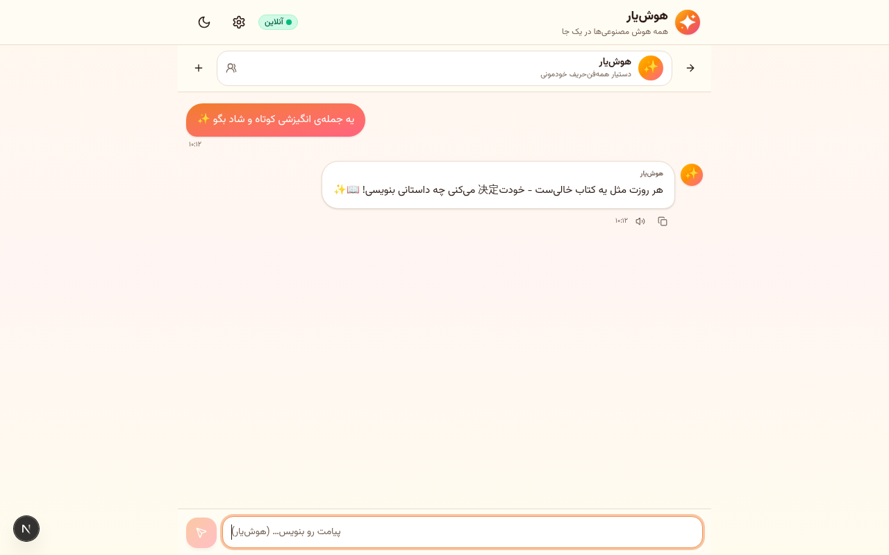
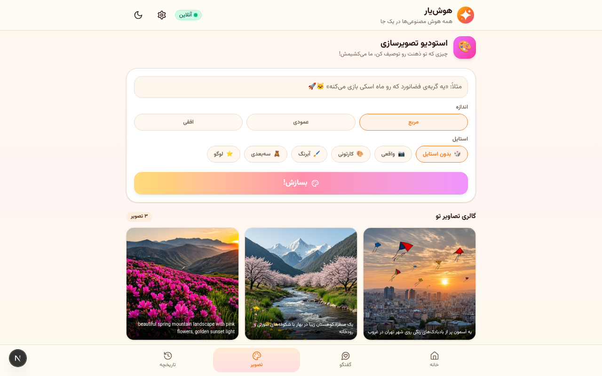
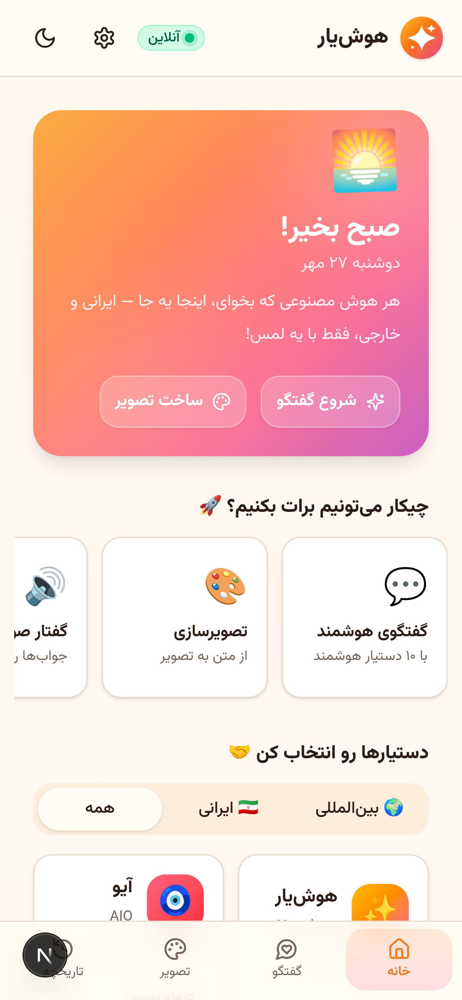

<div align="center">



# ✨ هوش‌یار

**همه‌ی هوش مصنوعی‌ها، در یک جا — ساده، شاد و فارسی**

[](../../releases)
[](../../actions/workflows/build-apk.yml)
[](#-دریافت-اپ-اندروید)
[](LICENSE)

هوش‌یار یک اپلیکیشن هابِ هوش مصنوعی برای کاربران فارسی‌زبان است: گفتگو با ۱۰ دستیار هوشمند (ایرانی و بین‌المللی)، تبدیل متن به تصویر، شنیدن پاسخ‌ها با صدا، و کارکرد کامل در حالت آفلاین — همه با رابط راست‌به‌چپ و تجربه‌ای کاملاً بومی.

</div>

---

## 📸 نگاهی به اپ

| خانه | گفتگو | تصویرسازی | موبایل |
|:---:|:---:|:---:|:---:|
|  |  |  |  |

> تم روشن و تاریک، اندازه‌ی قلم قابل تنظیم، و طراحی موبایل‌اول — برای همه‌ی سلیقه‌ها و همه‌ی چشم‌ها. 🌙☀️

---

## ✨ امکانات

- 💬 **گفتگو با ۱۰ دستیار هوشمند** — هر دستیار شخصیت، تخصص و لحن خودش را دارد
- 🎨 **تصویرسازی هوشمند** — متن فارسی را می‌نویسی، تصویر می‌گیری (۳ اندازه × ۵ استایل)
- 🔊 **گفتار صوتی** — هر پاسخ را با یک دکمه بشنو
- 📡 **حالت آفلاین واقعی** — پیام‌ها صف می‌شوند و به‌محض وصل شدن اینترنت خودکار ارسال می‌شوند
- 🗂️ **تاریخچه‌ی هوشمند** — عنوان‌گذاری خودکار فارسی، جستجو، تغییر نام، حذف
- 🌗 **تم روشن/تاریک + ۳ اندازه‌ی قلم** — دسترس‌پذیری برای همه
- 📱 **PWA + اندروید** — روی وب نصب می‌شود، APK رسمی هم دارد
- 🇮🇷 **فارسیِ کامل** — RTL، فونت وزیرمتن، تاریخ و ساعت شمسی (fa-IR)

## 🤝 دستیارها

| | ایرانی 🇮🇷 | تخصص | | بین‌المللی 🌍 | تخصص |
|:---:|:---|:---|:---:|:---|:---|
| ✨ | **هوش‌یار** | همه‌فن‌حریف خودمونی | 🤖 | **ChatGPT** | پاسخ جامع و گام‌به‌گام |
| 🧿 | **آیو** | کارهای روزمره | 🧠 | **Claude** | استدلال و نگارش حرفه‌ای |
| 🪶 | **دورنا** | ادبیات و زبان فارسی | 🌟 | **Gemini** | خلاقیت و ایده‌پردازی |
| ✍️ | **هوشا** | تولید محتوا و کپشن | 🔬 | **DeepSeek** | ریاضی و برنامه‌نویسی |
| 🦌 | **مارال** | گپ صمیمی و ساده | ⚡ | **Grok** | طنز و پاسخ رک |

---

## 📱 دریافت اپ اندروید

> آخرین نسخه‌ی آماده از [بخش Releases](../../releases/latest) دانلود کن:
> - **`hooshyar-debug.apk`** → نصب مستقیم روی گوشی برای تست (اجازه‌ی «منابع ناشناس» لازم است)
> - **`hooshyar-release.apk` / `.aab`** → نسخه‌ی امضاشده برای انتشار (اگر امضا تنظیم شده باشد)

هر push به `main`، به‌صورت خودکار APK جدید می‌سازد — بدون نیاز به اندروید استودیو. جزئیات کامل (امضا، انتشار در بازار و مایکت): **[docs/APK-GUIDE.md](docs/APK-GUIDE.md)**

> ⚠️ نکته: مغز اپ (هوش مصنوعی و دیتابیس) سمت سرور اجرا می‌شود. برای استفاده‌ی واقعی از APK باید وب‌اپ روی یک آدرس HTTPS منتشر شده و به‌عنوان `CAP_SERVER_URL` ثبت شود (بخش بعدی).

---

## 🚀 اجرای پروژه (حالت توسعه)

```bash
# پیش‌نیاز: Bun (یا Node 20+)
bun install

# ساخت دیتابیس (SQLite + Prisma)
bun run db:push

# اجرا روی localhost:3000
bun run dev
```

همین! بدون هیچ API key محلی — سرویس‌های هوش مصنوعی از طریق لایه‌ی سرور همان محیط در دسترس‌اند.

### اسکریپت‌های مفید

| دستور | کار |
|---|---|
| `bun run dev` | اجرای وب‌اپ |
| `bun run lint` | بررسی کیفیت کد |
| `bun run db:push` | همگام‌سازی اسکیمای دیتابیس |
| `bun run cap:sync` | همگام‌سازی کانفیگ/آیکون با اندروید |
| `bun scripts/make-icons.ts` | بازتولید همه‌ی آیکون‌ها از منبع SVG برند |

---

## ⚙️ پیکربندی

### آدرس سرور اپ (برای APK)
در گیت‌هاب: `Settings → Secrets and variables → Actions → تب Variables`

| متغیر | توضیح | مثال |
|---|---|---|
| `CAP_SERVER_URL` | آدرس HTTPS وب‌اپ منتشرشده | `https://app.example.ir` |

بعد از تنظیم، از تب Actions روی **Run workflow** بزن تا APK با آدرس جدید ساخته شود.

### امضای نسخه‌ی Release
در همان صفحه، تب **Secrets**:

| Secret | مقدار |
|---|---|
| `ANDROID_KEYSTORE_BASE64` | خروجی `base64 -w0 hooshyar.keystore` |
| `ANDROID_KEYSTORE_PASSWORD` | پسورد استور |
| `ANDROID_KEY_ALIAS` | نام مستعار کلید |
| `ANDROID_KEY_PASSWORD` | پسورد کلید |

---

## 🏗️ معماری

```
┌─────────────────────────────────────────────┐
│                اپ اندروید (APK)              │
│        قاب امن WebView (Capacitor)           │
│        آیکون · اسپلش · صفحه‌ی آفلاین         │
└──────────────────┬──────────────────────────┘
                   │  HTTPS (CAP_SERVER_URL)
┌──────────────────▼──────────────────────────┐
│              وب‌اپ Next.js 16                │
│  UI فارسی RTL · PWA · صف پیام آفلاین        │
│  ┌───────────────────────────────────────┐  │
│  │         API Routes (سمت سرور)         │  │
│  │  /api/chat (استریم SSE) · /api/image  │  │
│  │  /api/tts · /api/conversations        │  │
│  └──────────────────┬────────────────────┘  │
└─────────────────────┼───────────────────────┘
                      │
        ┌─────────────▼─────────────┐
        │   SQLite (Prisma) + سرویس  │
        │      هوش مصنوعی upstream   │
        └───────────────────────────┘
```

**تکنولوژی‌ها:** Next.js 16 (App Router) · TypeScript · Tailwind CSS 4 · shadcn/ui · Prisma (SQLite) · TanStack Query · Zustand · Framer Motion · Capacitor 8 · GitHub Actions

## 🧭 ساختار پروژه

```
├── src/
│   ├── app/                  # صفحه‌ی اصلی + ۸ مسیر API
│   ├── components/           # نماهای اپ (chat, image, history, ...)
│   ├── hooks/                # use-online, use-conversations, ...
│   └── lib/                  # providers, store, offline-queue, db
├── android/                  # پروژه‌ی اندروید (Capacitor)
├── .github/workflows/        # بیلد خودکار APK
├── assets/                   # منابع برند (آیکون/اسپلش)
├── scripts/make-icons.ts     # تولیدکننده‌ی آیکون‌ها از SVG
├── prisma/schema.prisma      # اسکیمای دیتابیس
└── docs/APK-GUIDE.md         # راهنمای کامل APK و انتشار
```

## 🗺️ نقشه‌ی راه

- [x] گفتگو با ۱۰ دستیار + استریم زنده
- [x] تصویرسازی از متن فارسی
- [x] گفتار صوتی پاسخ‌ها
- [x] حالت آفلاین با صف پیام
- [x] APK خودکار با GitHub Actions
- [ ] جستجوی وب فارسی 🔍
- [ ] اتصال مستقیم به APIهای واقعی دستیارها (با کلید کاربر)
- [ ] پشتیبانی از آپلود فایل و تصویر در گفتگو
- [ ] نسخه‌ی iOS

## ❓ سؤال‌های پرتکرار

**چرا اپ اندروید به اینترنت نیاز دارد؟**
هوش مصنوعی روی سرور اجرا می‌شود (کلیدها و قدرت پردازش آنجاست). آفلاین هم تاریخچه‌ی گفتگوها، ابزارها و صف پیام‌ها کار می‌کنند و بعد از اتصال ارسال می‌شوند.

**داده‌های من کجا ذخیره می‌شود؟**
گفتگوها و تصاویر در دیتابیس SQLite سمت سرور و تنظیمات اپ در دستگاه خودت. هیچ داده‌ای برای تبلیغات جایی نمی‌رود.

**چطور دستیار جدید اضافه کنم؟**
در `src/lib/providers.ts` یک آبجکت جدید با `id`، `name`، `emoji`، `gradient` و `persona` به آرایه‌ی `PROVIDERS` اضافه کن — همین!

## 📄 مجوز

[MIT](LICENSE) — آزاد برای استفاده، تغییر و انتشار.

<div align="center">
<sub>ساخته شده با ❤️ برای کاربران فارسی‌زبان</sub>
</div>
